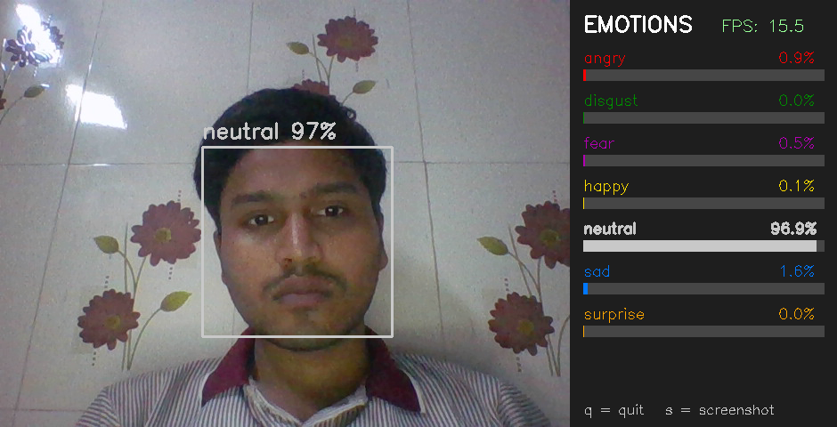
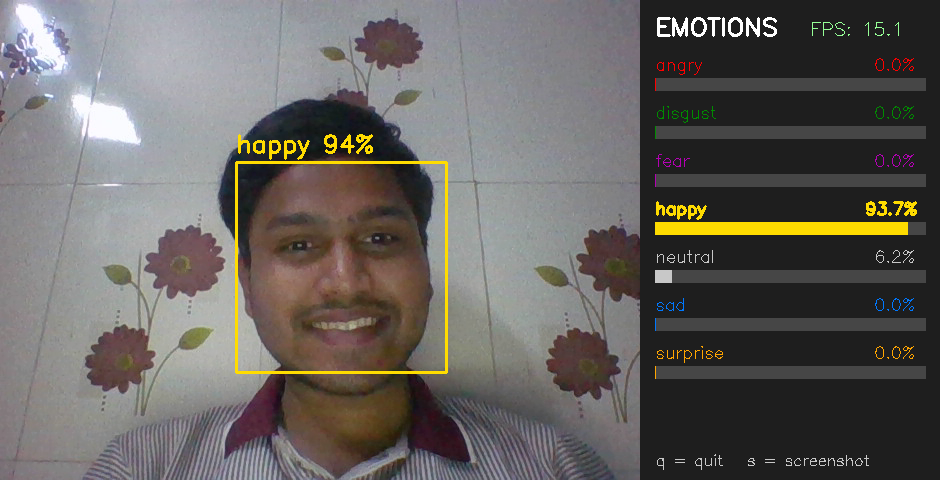

# Facial Emotion Recognition

A real-time facial emotion recognition app built with a Convolutional Neural Network (CNN), TensorFlow/Keras and OpenCV. The model is trained on the FER2013 dataset and used in a live webcam application that detects faces and shows the predicted emotion with confidence scores.

## Demo

| Neutral | Happy |
|---|---|
|  |  |

## Features

- CNN trained on **FER2013** (7 emotions, 48x48 grayscale face images)
- Live webcam application using **OpenCV** with real-time face detection
- Emotion prediction with confidence bars and FPS display
- Session logging to CSV, with a timeline graph and summary report generated using Pandas and Matplotlib

## Model Performance

| Metric | Value |
|---|---|
| Dataset | FER2013 |
| Epochs trained | 60 |
| Final training accuracy | 65.29% |
| Final validation accuracy | 64.11% |
| Test accuracy | 64.78% |

FER2013 is a hard benchmark: the images are small, low-quality and some labels are ambiguous, so accuracy in the 60s is typical for a CNN trained from scratch.

## Tech Stack

Python, TensorFlow/Keras, OpenCV, NumPy, Pandas, Matplotlib

## Project Structure

```
emotion-recognition/
├── model/
│   ├── emotion_model.keras   # trained model
│   ├── class_names.json      # emotion labels
│   └── history.json          # training history (accuracy, loss per epoch)
├── screenshots/              # demo screenshots used in this README
├── app.py                    # live webcam application
├── train_model.py            # model training script
├── test_face.py              # quick test script
├── report.py                 # session report and timeline graph
├── make_report.py            # report generation
├── run_demo.bat              # one-click launcher (Windows)
└── requirements.txt          # dependencies
```

## How to Run

1. Clone the repository
   ```
   git clone https://github.com/ShkNaushad/emotion-recognition.git
   cd emotion-recognition
   ```
2. Create and activate a virtual environment (Windows)
   ```
   python -m venv venv
   venv\Scripts\activate
   ```
3. Install the dependencies
   ```
   pip install -r requirements.txt
   ```
4. Start the webcam app
   ```
   python app.py
   ```

On Windows you can also double-click `run_demo.bat` after editing the folder path inside it to match your machine.

## Training the Model Yourself

The trained model is already included in the `model/` folder, so you only need this section if you want to retrain it.

1. Download the **FER2013** dataset (train/test image folders) from Kaggle.
2. Open `train_model.py` and change the `BASE` (dataset) and `SAVE` (output) paths. The script was originally run on Google Colab with a T4 GPU.
3. Run `python train_model.py`.

## Author

**Naushad Shaikh**
B.Sc. Data Science student
GitHub: [ShkNaushad](https://github.com/ShkNaushad)
